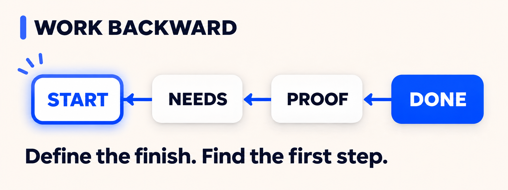

# Work Backward

An AI skill that interviews you **one question at a time**, defines what success would look like, and works backward to a plan you can act on.

Start with a result you want, even if it is still vague. The assistant helps you decide what would prove success, traces what must be true before that result is possible, and finds the next useful action.

## Use it

Install the complete [`skills/work-backward`](skills/work-backward) folder using your assistant's supported skill installation method. Keep the reference file with `SKILL.md`.

If Work Backward is already installed in ChatGPT, select it from the `@` menu and describe your goal. In any compatible assistant, you can ask:

> Use Work Backward to help me define what success would look like for this project, decide how to verify it, and work backward to the first action. Ask me one question at a time.

For an assistant that can read a checkout directly:

> Read skills/work-backward/SKILL.md and use it to help me work backward from my goal: [describe the result you want].

You do not need a finished brief. Share the context, constraints, files, and references you already have. You can correct a recommendation, delegate a choice, or ask the assistant to proceed whenever enough is clear.

## The flow

| Stage | The question it resolves |
| --- | --- |
| **Destination** | What would the finished, successful result look like? |
| **Evidence** | What could we inspect, demonstrate, or measure to know it worked? |
| **Prerequisites** | What must already be true immediately before that result is possible? |
| **Unknowns** | What needs research, an experiment, a concrete example, or your judgment? |
| **Action** | What is the smallest practical sequence forward, and what can start now? |

Each answer shapes the next question. The assistant recommends a direction when it has enough context, keeps proposals separate from your decisions, and looks up facts it can establish itself.

When a preference is hard to describe, a small example or draft can provide something to react to. When a goal is already well specified, the assistant skips questions that are already answered.

## What you get

A compact brief with:

1. The goal in plain language.
2. Success criteria and how each will be checked.
3. A backward map of the prerequisites.
4. A forward plan with completion checks.
5. Material assumptions and open issues.
6. A concrete first action.

If you asked for planning, it delivers the brief. If you already requested execution, it continues within that authorization. Planned checks remain distinct from results that have actually been verified.

## Examples

### Software

> Use Work Backward to help me improve our CSV import flow. Customers struggle to recover when an import fails. I want them to fix the problem and finish without contacting support. Read the existing flow, ask one question at a time, and work backward from a demonstration that proves the experience works.

### Visual work

> Use Work Backward to help me create a website that feels right for my business. I have a few references but cannot yet explain which qualities matter. Help me identify what I want, decide how we will review it, and work backward to the first useful draft.

### Business

> Use Work Backward to plan a six-week pilot with three interested retailers. I want to learn whether repeat orders justify expanding it. Help me separate the work we control from the outcomes we need to observe, then work backward to the first action.

## Inspiration and source thread

This skill grew out of [Brian Fioca's November 18, 2026 thread about working backward from a verifiable goal](https://x.com/bfioca/status/2123172564910686242).

[Bryan McAnulty's reply](https://x.com/BryanMcAnulty/status/2123247035101098129) makes the idea concrete: describe the outcome you want, determine how to verify it, and use references to clarify subjective quality. The thread also discusses using an initial result to discover preferences and refining the brief when the direction is wrong.

The interview format is inspired by [Matt Pocock's Grill Me](https://www.aihero.dev/skills-grill-me). Work Backward centers that questioning on the destination, the evidence of success, and the prerequisites for reaching it.

The workflow is model independent. The source thread's model rankings and anecdotes are motivation for the discussion, not requirements or benchmark claims made by this skill.

## Files

| File | Purpose |
| --- | --- |
| [`skills/work-backward/SKILL.md`](skills/work-backward/SKILL.md) | The reusable interview and backward-planning workflow. |
| [`skills/work-backward/references/question-patterns.md`](skills/work-backward/references/question-patterns.md) | Question patterns and examples across different types of work. |
| [`skills/work-backward/agents/openai.yaml`](skills/work-backward/agents/openai.yaml) | Display name, description, and starter prompt for compatible clients. |
| [`assets/work-backward-imagegen.png`](assets/work-backward-imagegen.png) | The ImageGen-created header shown above. |

The exact ImageGen request is retained in [`assets/imagegen-prompt.txt`](assets/imagegen-prompt.txt).
